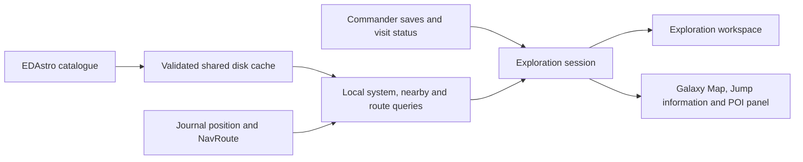

# EDAstro exploration and POI integration

Date checked: 2026-10-11, America/Chicago. Recorded response headers were dated 2026-10-12 01:15:28–01:15:51 UTC by the server, which is the same evening in the client's timezone.

SrvSurvey revision at investigation: `9ca4a50d65151eb74a2221340f11046c76b96bd2`.

Scope: first-party EDAstro documentation, bounded public GET probes, the EDDiscovery wiki, and EDDiscovery's actual current source and pinned shared libraries. No uploads or application implementation were performed. Payload counts and response quirks below are dated observations, not guaranteed contracts.

## Recommendation

**Use EDAstro's Galactic Exploration Catalog (GEC) as a cached exploration destination catalog.** Its strongest contribution is curated places worth visiting: scenery, unusual planets and stars, green gas giants, nebulae, notable stellar phenomena, and historical/community locations. Enrich the existing Spansh-imported routes, next-jump information, and Galaxy Map panel with named POIs. Add an optional passive overlay for known POIs in the current system. Keep individual POIs distinct even when they share a system. These are implementation recommendations based on the payload and source evidence below.

Design refinement from the user: retain the existing Spansh URL route workflow and next-jump presentation. POI integration adds context to those surfaces; it does not introduce a route planner, automatically insert detours, or change route progress. Prioritize a current-system overlay that appears when matching catalogue entries exist. Route-corridor ranking and itinerary insertion are deferred ideas, not part of the initial integration.

EDDiscovery confirms that this is practical: it downloads GEC's entire catalog into `gecmapping.json`, loads that file locally, and refreshes it in the background once it is at least seven days old. It also uses EDAstro's map images as a separate kind of galaxy-map overlay. [GEC downloader](https://github.com/EDDiscovery/EliteDangerousCore/blob/13bb0c0921851f149cce6ab970fa17460f88013e/EliteDangerous/3rdPartyInterfaces/GEC/GEC.cs#L19-L24), [refresh scheduling](https://github.com/EDDiscovery/EDDiscovery/blob/5782926502417199c65d578f7de3b11b50278d75/EDDiscovery/EDD/EDDiscoveryControllerHelpers.cs#L56-L71), [map-image presets](https://github.com/EDDiscovery/EDDiscovery/blob/5782926502417199c65d578f7de3b11b50278d75/EDDiscovery/UserControls/3DMap/MapMenu.cs#L602-L634).

## Documented retrieval surface

The documentation states **100 requests per 15 minutes**, with counters in HTTP response headers. System queries accept names or ID64s; comma-separated batches contain at most ten systems. GEC uses EDSM's GMP-compatible JSON format. Combined-catalog identity is **`(source, id)`**, because IDs overlap. [EDAstro API details](https://edastro.com/api-details.html).

| Path on `https://edastro.com` | Documented purpose |
| --- | --- |
| `/api/starsystem?q={name-or-id64}` | System and its known contents |
| `/api/starsystem?q={system1},{system2},…` | Up to ten systems |
| `/gec/json/all` | GEC catalog |
| `/gec/json/combined` | GEC plus GMP catalog |
| `/gec/json/rare` | Rare POIs |
| `/gec/json/single/{poi-id}` | One GEC POI |
| `/gec/json/id64/{system-id64}` | One POI for a system |
| `/gec/json/nearest/{x}/{y}/{z}` | One nearest POI |
| `/gec/json/nearest/{x}/{y}/{z}/{minrating}` | Nearest with minimum explorer rating |
| `/gec/json/favorites/{user-id-or-name}` | User's favorites |
| `/gec/json/categories` | Active categories |
| `/gec/json/stats` | Catalog totals |
| `/gec/new/{system-name}[/{poi-name}]` | Browser submission form with prefilled values |

Source for this table: [EDAstro API details](https://edastro.com/api-details.html). Submission forms are links for the commander to use; they are not a documented POI-write API.

No credentials or session cookies were supplied for the public retrieval probes; they returned HTTP 200. GEC responses included `RateLimit-Limit`, `RateLimit-Remaining`, and `RateLimit-Reset`, and advertised `Access-Control-Allow-Origin: *`. In the inspected provider implementation the rate bucket is keyed by `REMOTE_ADDR`, and reset is a relative seconds value. Do not interpret it as a Unix timestamp or assume a separate budget for every feature. [Provider rate-limit implementation](https://github.com/Orvidius/gec/blob/fb0bd57086dcf592cca683435c2ef2891c39b5cf/poi#L978-L1053). The probes did not exhaust the allowance or test HTTP 429 behavior.

## What the live catalog contains

A single gzip-enabled GET of [`/gec/json/combined`](https://edastro.com/gec/json/combined) returned **2,776 objects: 653 GEC and 2,123 GMP**. The decoded JSON was **6,216,387 bytes**, versus **1,166,055 bytes** transferred with gzip. There were **561 colliding numeric IDs** across sources. This is small enough for a disk snapshot and local searches; it does not require a request per jump, filter change, or overlay refresh. These are measurements from this investigation, not published capacity limits.

The GEC objects had these fields; GMP records in the same response were substantially thinner:

| Concept | GEC fields observed | Parsing implication |
| --- | --- | --- |
| Identity | `id`, `source`, `id64`, `galMapSearch` | Provider ID, source, system ID64, and system name are separate concepts. Preserve ID64 as a 64-bit integer. |
| Classification | `type`, `type2`, `categoryId`, `categoryId2`, `region`, `rare` | Support primary and secondary categories; `region` is a display name. Empty secondary values occurred. |
| Galactic position | `coordinates`, `solDistance` | `coordinates` is an XYZ triple for the system, not a surface target. Compute distance from the commander's position locally. |
| Description | `name`, `summary`, `descriptionMardown`, `descriptionHtml` | The misspelling **`descriptionMardown`** is intentional compatibility. Use summary first; treat rich descriptions as external content. |
| Scores | `rating`, `curation`, `avgStars`, `votes` | Distinct values; do not label `rating` as a five-star average. |
| Links/media/support | `poiUrl`, `galMapUrl`, `mainImage`, `callsign` | GEC page and EDSM page are different links; a callsign is not confirmation of current carrier location/services. |
| Optional surface position | `latitude`, `longitude` | Only 41 of 653 GEC objects had both. No structured body name or body ID was present. |

The field list and statistics come from the dated [`combined` response](https://edastro.com/gec/json/combined); provider serialization confirms the spelling and optional fields. [GEC serializer](https://github.com/Orvidius/gec/blob/fb0bd57086dcf592cca683435c2ef2891c39b5cf/poi#L1246-L1309).

GMP records contained `id`, `type`, `name`, `galMapSearch`, `galMapUrl`, `coordinates`, `descriptionMardown`, `descriptionHtml`, and `source`. They had no GEC rating, structured categories, ID64, surface position, summary, or image field. **94 GMP entries lacked a system name**, even though their coordinate triples were present. They can be shown as map objects but should not automatically become jump-route stops. [Dated combined response](https://edastro.com/gec/json/combined), [GMP serializer](https://github.com/Orvidius/gec/blob/fb0bd57086dcf592cca683435c2ef2891c39b5cf/poi#L1313-L1329).

The 18 live category entries included `Undefined`, `Stellar Features`, `Planetary Features`, `Planetary Circumnavigation`, `Sights and Scenery`, `Green Gas Giants`, `Deep Space Outpost`, `Organic`, `Mystery and Xenology`, `Historical`, `Tourist Beacons`, `Memorials`, `Legacy`, `Community`, `Notable Stellar Phenomena`, `Nebulae`, `Glitches`, and `Inhabited System`. Each category supplied `id`, `name`, and `curationOnly`; `Glitches` was marked curation-only. Load these values dynamically and retain unknown categories. [Dated categories response](https://edastro.com/gec/json/categories).

The source's catalog query excludes unapproved, hidden, and deleted GEC entries. It supplies neither an update timestamp nor moderation flags in each exported object, so a cached entry cannot independently prove when its description last changed. Refresh by snapshot replacement, retaining a local fetch timestamp. [Provider catalog selection](https://github.com/Orvidius/gec/blob/fb0bd57086dcf592cca683435c2ef2891c39b5cf/poi#L1055-L1087).

### Ratings and trust

The official scoring page defines explorer `rating` on a **1–10** scale influenced by both average **1–5** stars and number of votes. New entries with few votes start lower; the full ten-point scale becomes available with 100 votes. The site's interactive map uses a minimum explorer rating of 3. Therefore a useful default is “rating ≥3,” with an option to include less-rated discoveries; show average stars and vote count separately. `curation` is an additional returned score, but no equally precise public contract for its meaning was established in this investigation. [GEC scoring explanation](https://edastro.com/gec/scoring).

GEC asks for permanent POIs, requires latitude/longitude for surface locations, and defines `Legacy` as locations present only in Elite 3.8. Its team explicitly cautions that it cannot visit most submissions and conditions can change. A curated description is evidence of a reported attraction; it is not confirmation of current biology payout, first footfall, first discovery, current carrier services, or access permits. [GEC rules and category definitions](https://edastro.com/gec/rules).

### Retrieval quirks verified during this investigation

| Probe | Observed response | Consequence |
| --- | --- | --- |
| [`id64/2587943`](https://edastro.com/gec/json/id64/2587943) | One object, GEC 28. The downloaded catalog also contained GEC 43 in the same Great Annihilator system. | The system endpoint is not an exhaustive system-to-POIs lookup. Group the snapshot into lists by ID64/name. |
| [`single/999999999`](https://edastro.com/gec/json/single/999999999) | HTTP 200 with `{}`. | Empty object is a possible no-result state; HTTP success does not guarantee a POI. |
| [`nearest/-6661.41/980.688/3409.75`](https://edastro.com/gec/json/nearest/-6661.41/980.688/3409.75) | HTTP 200, GEC 254 at Sol; `distance: null`. These coordinates exactly matched GEC 72 in the snapshot. No minimum-rating parameter was supplied. | This probe did not provide the expected closest POI. Use locally computed distances; do not depend on this endpoint for correctness without contract verification. |
| [`nearest/354.844/-42.4375/22997.2`](https://edastro.com/gec/json/nearest/354.844/-42.4375/22997.2) | HTTP 200, also GEC 254 at Sol and `distance: null`, despite two catalog entries at the queried position. No minimum-rating parameter was supplied. | Second bounded example of the same discrepancy; it does not establish behavior for every query or a future deployment. |

The provider source returns only the first matching row for `id64`, consistent with the tested limitation. Its empty default result is `{}`. [System/single lookup implementation](https://github.com/Orvidius/gec/blob/fb0bd57086dcf592cca683435c2ef2891c39b5cf/poi#L1091-L1110).

The inspected serializer conditionally emits latitude/longitude using truthiness. A valid zero coordinate can therefore be absent in that source version. Absence must remain unknown; never fill in a missing surface coordinate with zero. No POI endpoint inspected provides structured body identity to go with those coordinates. **A surface navigation overlay needs a commander-confirmed body and coordinates before it can safely create a target.** [Serializer conditions](https://github.com/Orvidius/gec/blob/fb0bd57086dcf592cca683435c2ef2891c39b5cf/poi#L1256-L1284).

## Precisely how EDDiscovery uses EDAstro

Source snapshot: EDDiscovery `5782926502417199c65d578f7de3b11b50278d75` (2026-10-10), its pinned EliteDangerousCore submodule `13bb0c0921851f149cce6ab970fa17460f88013e`, and pinned BaseUtilities `b0f7e0f05e1a91b891111321c0d93f1cc16363d4`. These are the checked current repository revisions, not a claim about every installed release. [EDDiscovery commit and submodules](https://github.com/EDDiscovery/EDDiscovery/tree/5782926502417199c65d578f7de3b11b50278d75).

1. **Direct catalog retrieval:** `GECClass.DownloadGECFile` calls `https://edastro.com/gec/json/all`, not `combined`, `nearest`, or `starsystem`. [Downloader](https://github.com/EDDiscovery/EliteDangerousCore/blob/13bb0c0921851f149cce6ab970fa17460f88013e/EliteDangerous/3rdPartyInterfaces/GEC/GEC.cs#L19-L24).
2. **First run and local use:** initialization fetches a missing `gecmapping.json` unless system loading is disabled. It parses GEC first with a numeric ID offset, then an embedded legacy EDSM `edsmgmo` resource, tourist-beacon CSV, and Marx's nebula list. Thus the current GEC feed and legacy GMP data have separate ingestion paths. [Initialization](https://github.com/EDDiscovery/EDDiscovery/blob/5782926502417199c65d578f7de3b11b50278d75/EDDiscovery/EDD/EDDiscoveryForm.cs#L561-L596).
3. **Refresh cadence:** the background refresh only acts on an existing file when the stored successful-fetch timestamp is at least seven days old; the comment explicitly says the refreshed file is for next time. The inspected method does not reparse the new snapshot into the currently running catalog. [Refresh code](https://github.com/EDDiscovery/EDDiscovery/blob/5782926502417199c65d578f7de3b11b50278d75/EDDiscovery/EDD/EDDiscoveryControllerHelpers.cs#L56-L71).
4. **HTTP cache support:** the shared downloader requests gzip/deflate, supports ETag or Last-Modified conditions when saved metadata exists, accepts HTTP 304, and writes via a temporary file. This is client capability: the live GEC probe exposed neither ETag nor Last-Modified, so conditional server caching is not established. [HTTP downloader](https://github.com/EDDiscovery/BaseUtilities/blob/b0f7e0f05e1a91b891111321c0d93f1cc16363d4/BaseUtilities/HTTP/HttpCom.cs#L407-L443), [temporary-file replacement](https://github.com/EDDiscovery/BaseUtilities/blob/b0f7e0f05e1a91b891111321c0d93f1cc16363d4/BaseUtilities/HTTP/HttpCom.cs#L450-L509).
5. **Map-object conversion:** `GalacticMapObject` retains name, description, primary type, map URL, and galactic coordinates; HTML is converted to text with a Markdown fallback. It does not retain ratings, secondary category, image, latitude/longitude, or source POI identity as distinct metadata. `GalacticMapping` merges single-point objects within 0.25 of each XYZ component. This is suitable for uncluttered map markers but would lose distinctions needed in a POI list. [Object conversion](https://github.com/EDDiscovery/EliteDangerousCore/blob/13bb0c0921851f149cce6ab970fa17460f88013e/EliteDangerous/Bodies/GMO/GalacticMapObject.cs#L72-L141), [merging](https://github.com/EDDiscovery/EliteDangerousCore/blob/13bb0c0921851f149cce6ab970fa17460f88013e/EliteDangerous/Bodies/GMO/GalacticMapping.cs#L112-L155).
6. **In-game note overlay:** the note panel looks up the travel-history system in this local `GalacticMapping` and displays its description. It still labels the content `GMP`, although GEC is loaded into the same collection. There is no per-jump GEC API request in this display path. [Note overlay](https://github.com/EDDiscovery/EDDiscovery/blob/5782926502417199c65d578f7de3b11b50278d75/EDDiscovery/UserControls/Overlays/UserControlNotePanel.cs#L100-L143), [wiki](https://github.com/EDDiscovery/EDDiscovery/wiki/4.-Note-Panel).
7. **Raster galaxy-map layers:** the 3D-map menu includes EDAstro exploration heat maps and Codex/organic distribution charts. Its presets place them at `(6140, 0, 18850)`, scaled to `(102300, 102300)`, with opacity `0.4`. Those values are EDDiscovery's image presets, not an API coordinate-reference contract; any future SrvSurvey map needs independent alignment checks. [Presets](https://github.com/EDDiscovery/EDDiscovery/blob/5782926502417199c65d578f7de3b11b50278d75/EDDiscovery/UserControls/3DMap/MapMenu.cs#L602-L634), [3D-map wiki](https://github.com/EDDiscovery/EDDiscovery/wiki/4.-Map-3D-Panel).
8. **Separate upload integration:** `EDAstroClass` gets accepted journal-event types and POSTs journal batches; the application calls that path only when the commander has `SyncToEDAstro` enabled, whose default is false. That is a contribution feature, separate from retrieving exploration POIs. No calls to EDAstro's `starsystem` retrieval endpoint were found in the inspected application/shared-core C# sources. [API upload class](https://github.com/EDDiscovery/EliteDangerousCore/blob/13bb0c0921851f149cce6ab970fa17460f88013e/EliteDangerous/3rdPartyInterfaces/EDAstro/EDAstroClass.cs#L30-L66), [commander default](https://github.com/EDDiscovery/EliteDangerousCore/blob/13bb0c0921851f149cce6ab970fa17460f88013e/EliteDangerous/DB/User/EDCommander.cs#L76), [event dispatch](https://github.com/EDDiscovery/EDDiscovery/blob/5782926502417199c65d578f7de3b11b50278d75/EDDiscovery/EDD/EDDiscoveryFormJournalEvents.cs#L141-L144).

The useful precedent is **download occasionally, query locally, feed several views from one catalog**. SrvSurvey should preserve richer POI metadata and independent provider identities rather than copying EDDiscovery's position-based merging.

## EDDiscovery's separate journal-upload protocol

Follow-up checked 2026-10-12 against the same pinned EDDiscovery/shared-core revisions above. **EDDiscovery has dedicated EDAstro upload code**, separate from EDDN contributions and the GEC download. EDAstro's submission page describes this as filling gaps around fleet carriers, Codex, and Odyssey organic scans; it asks users to enable both EDDN and EDAstro submissions. [Official submission overview](https://edastro.com/api-info.html).

**Special access / application whitelisting:** Follow-up provider communication supplied on 2026-10-12 confirms that no application registration or whitelisting is required. EDDiscovery sends no API key, token, or login with these requests. SrvSurvey uses its own application identity and the provider's requested-event list. This clarification resolves the earlier uncertainty about approval; it does not guarantee acceptance of every event or payload. [Current parity audit and provider clarification](edastro-uploader-parity-audit-2026-10-12.md), [client requests](https://github.com/EDDiscovery/EliteDangerousCore/blob/13bb0c0921851f149cce6ab970fa17460f88013e/EliteDangerous/3rdPartyInterfaces/EDAstro/EDAstroClass.cs#L47-L66), [provider documentation](https://edastro.com/api-info.html).

- **Protocol:** `EDAstroClass` GETs `https://edastro.com/api/accepting` and POSTs `https://edastro.com/api/journal`. The POST body is a JSON array whose first object contains `appName`, `appVersion`, and `odyssey`, followed by journal objects. The default application name is `EDDiscovery`; no commander name or API key is added to that envelope. [API class](https://github.com/EDDiscovery/EliteDangerousCore/blob/13bb0c0921851f149cce6ab970fa17460f88013e/EliteDangerous/3rdPartyInterfaces/EDAstro/EDAstroClass.cs#L24-L66).
- **Commander setting:** “Send Events to EDAstro” is stored per commander as `SyncToEDAstro`, defaulting to false. New processed journal entries call the uploader when it is enabled. This switch is separate from EDDN's setting. [Checkbox](https://github.com/EDDiscovery/EliteDangerousCore/blob/13bb0c0921851f149cce6ab970fa17460f88013e/EliteDangerous/DB/User/CommanderForm.Designer.cs#L963-L982), [default](https://github.com/EDDiscovery/EliteDangerousCore/blob/13bb0c0921851f149cce6ab970fa17460f88013e/EliteDangerous/DB/User/EDCommander.cs#L76), [live trigger](https://github.com/EDDiscovery/EDDiscovery/blob/5782926502417199c65d578f7de3b11b50278d75/EDDiscovery/EDD/EDDiscoveryFormJournalEvents.cs#L120-L146).
- **Filtering/batching:** the static worker obtains the accepted-event list once, filters before enqueueing and before sending, and clones journal JSON with `EDD*` properties removed. It batches at most 200 journal objects and waits ten seconds between groups. The batch `odyssey` flag is true if any included event is Odyssey. [Worker](https://github.com/EDDiscovery/EliteDangerousCore/blob/13bb0c0921851f149cce6ab970fa17460f88013e/EliteDangerous/3rdPartyInterfaces/EDAstro/EDAstroSync.cs#L34-L145).

A read-only GET of [`/api/accepting`](https://edastro.com/api/accepting) returned HTTP 200 at server time **2026-10-12 06:53:57 UTC**, with `CarrierJumpRequest`, `CarrierStats`, `Docked`, and `ScanOrganic`. It did not include `CodexEntry` in this particular response. The provider controls the list; the documentation's broader purposes are not a promise that every named event is accepted at every moment. No journal POST was performed.

**Limits of the inspected implementation:** an empty accepted-event set permits every event; a null lookup result retains that permissive state. The worker ignores `SendJournalEvents`' success result and has no durable outbox or explicit retry in this class. Removing `EDD*` fields is not a general anonymization pass. EDAstro states that its selected data does not identify people, but that provider statement should not be broadened into a guarantee about every payload during an allowlist failure. [Worker predicates and send result handling](https://github.com/EDDiscovery/EliteDangerousCore/blob/13bb0c0921851f149cce6ab970fa17460f88013e/EliteDangerous/3rdPartyInterfaces/EDAstro/EDAstroSync.cs#L38-L112), [provider's privacy statement](https://edastro.com/api-info.html).

No normal bulk-history/backfill call to this uploader was found: the other application callsite is a debug right-click command which queues **one selected history entry**, without checking the normal commander switch in that handler. EDAstro also supplies its own web journal-upload page for older data. [Debug-menu visibility](https://github.com/EDDiscovery/EDDiscovery/blob/5782926502417199c65d578f7de3b11b50278d75/EDDiscovery/UserControls/History/HistoryGridRightClickMenu.cs#L88-L95), [selected-entry handler](https://github.com/EDDiscovery/EDDiscovery/blob/5782926502417199c65d578f7de3b11b50278d75/EDDiscovery/UserControls/History/HistoryGridRightClickMenu.cs#L478-L483), [official upload guidance](https://edastro.com/api-info.html).

## Other EDAstro data and overlay opportunities

### Optional system enrichment

[`/api/starsystem?q=10477373803`](https://edastro.com/api/starsystem?q=10477373803) returned a **one-element array**, although the documentation describes the scalar form as an object. Its Sol record contained `stars`, `planets`, `barycenters`, `stations`, `carriers`, `codex`, aggregate valuable-planet counts, FSS progress/completeness, region, coordinates, boxel information, and multiple timestamps. Planet fields included typed parents, radius/gravity/orbits, rings, materials, atmospheric composition, landability, and `organic`. This is richer contextual data, but it is a separately shaped provider response rather than a drop-in replacement for another system-body client.

[`q=10477373803,2587943`](https://edastro.com/api/starsystem?q=10477373803,2587943) returned Great Annihilator before Sol, the reverse of request order. Match by ID64/name rather than array position. A bounded mixed valid/invalid-name probe also returned an unexpected extra object (`name: Sol`, `id64: 12345`), so successful responses must be identity-checked before merging. That anomaly needs provider clarification before this endpoint is adopted; this research did not pursue its cause. [Exact mixed-name probe](https://edastro.com/api/starsystem?q=Sol,ThisSystemDoesNotExistSrvSurveyResearch).

EDAstro describes its bulk provenance as real-time EDDN submissions plus EDSM gap-filling every few days. The data is a record of community contributions, not the game's full universe or proof that absent bodies/features do not exist. Multiple provider timestamps should not be compressed into a promise of current completeness. [EDAstro data sources](https://edastro.com/datasources.html).

### Galaxy heat maps and curated candidate lists

EDAstro publishes heat maps and Codex distributions, normally updating maps/spreadsheets every two days and Codex maps weekly. It warns that distributions reflect commander activity and scan submissions, as well as actual galaxy structure. An exploration-density layer can suggest quieter areas; it cannot promise undiscovered systems. A Codex layer can suggest regions containing reported phenomena; it cannot locate a new surface specimen. [Map/chart documentation](https://edastro.com/mapcharts/).

Beyond GEC, the files page lists separate CSVs for close landable moons of Earth-like worlds, close landables with large stars in the sky, moons near ring edges, deeply nested moons, high-body-count systems, unusual stars, DSSA deployments, and a broader combined POI spreadsheet. These are useful future “interesting destinations” imports. They are not equivalent to `/gec/json/combined`; CSV columns can change, and some datasets are hundreds of megabytes or larger. Prefer selected small catalogs with header-based parsing and a separate refresh policy, after their reuse terms are established. No CSV files were downloaded for this investigation. [EDAstro files and data](https://edastro.com/mapcharts/files.html).

## Provenance and reuse

GEC's footer explicitly licenses its content under **CC BY-NC-SA 3.0**. Plan to retain source-page links, supplied creator credits, and the license notice alongside copied descriptions/media; the Creative Commons terms require attribution, noncommercial use, and the same license for distributed adaptations. These content terms are separate from the application code's license. [GEC content notice](https://edastro.com/gec/), [Creative Commons terms](https://creativecommons.org/licenses/by-nc-sa/3.0/).

The GEC server-code repository has its own GPL-3.0 license; the inspected EDDiscovery helper code is Apache-2.0. Neither code license licenses all data, photographs, or legacy GMP material served by an endpoint. The non-GEC EDAstro map/files pages show an all-rights-reserved footer; this investigation did not establish an equivalent explicit grant for redistributing those images/datasets or every upstream GMP item. Source-linking is immediately useful; establish those particular content terms before packaging map images or CSV data with SrvSurvey. [GEC code repository](https://github.com/Orvidius/gec), [EDDiscovery helper license](https://github.com/EDDiscovery/EliteDangerousCore/blob/13bb0c0921851f149cce6ab970fa17460f88013e/EliteDangerous/3rdPartyInterfaces/GEC/GEC.cs#L1-L12), [map page footer](https://edastro.com/mapcharts/), [files page](https://edastro.com/mapcharts/files.html).

## SrvSurvey's current integration points

Repository inspected at `9ca4a50d65151eb74a2221340f11046c76b96bd2`. The following are local-code findings; the recommendations below are proposed work, not implemented features.

| Existing surface | Evidence | Integration implication |
|---|---|---|
| Exploration main-window workspace | [ExplorationView.axaml](../../src/SrvSurvey.Desktop/Views/ExplorationView.axaml) currently presents estimated value, jumps, distance, bodies, profile status, and reset controls. | Add destination discovery below the existing totals, preserving every current action. This would give the workspace a practical planning purpose. |
| External system/body enrichment | [SystemBodyDataClient](../../src/SrvSurvey.Core/Exploration/SystemBodyDataClient.cs) already fetches EDSM bodies and Spansh dumps concurrently, validates identity, and returns separate provider snapshots. | Make GEC a separate destination catalogue. Assess EDAstro's star-system endpoint later as an optional enrichment fallback. |
| EDAstro links | [BiologyCodexBingoViewModel](../../src/SrvSurvey.Desktop/ViewModels/BiologyCodexBingoViewModel.cs) and [WellKnownUris](../../src/SrvSurvey.Core/Network/WellKnownUris.cs) already launch EDAstro maps and Codex distribution charts. | Current integration is browser links; there is no EDAstro retrieval client in the audited source. Retain those links alongside richer POI data. |
| Galaxy Map overlay | [GalaxyMapOverlayViewModel](../../src/SrvSurvey.Desktop/ViewModels/GalaxyMapOverlayViewModel.cs) resolves a selected target, final route destination, next hop, or current system from journal/status/route evidence. | Annotate those recognized systems with matching POIs. The existing implementation does not expose arbitrary cursor-hover selection in the game's map. |
| Jump information | [JumpInfoViewModel](../../src/SrvSurvey.Desktop/ViewModels/JumpInfoViewModel.cs) already tracks current coordinates, jump target, plotted/followed routes, and timed overlay presentation. Its existing POI summary reports Spansh body/genus/station/carrier/war counts. | Add named GEC attractions within the existing detail area, retaining those counts and the current jump/route logic. |
| Personal bookmarks | [GalacticBookmark and BookmarkCatalog](../../src/SrvSurvey.Core/Navigation/BookmarkCatalog.cs) support coordinates, notes, ratings, favorites, and a POI category. | Reuse the personal-save workflow, with explicit external identity/provenance. Do not automatically import the entire catalogue into personal bookmarks. |
| Followed routes | [FollowRouteHop](../../src/SrvSurvey.Core/Routes/FollowRouteDocument.cs) already carries system address, coordinates, and notes; [RouteWorkspaceViewModel](../../src/SrvSurvey.Desktop/ViewModels/RouteWorkspaceViewModel.cs) supports imported itineraries. | Derive a POI badge/detail from each existing hop's identity without modifying its notes, order, reachability, or progress. |
| Journals and journeys | [JournalProjection](../../src/SrvSurvey.Desktop/ViewModels/JournalProjection.cs), [DesktopJournalProjectionAdapter](../../src/SrvSurvey.Desktop/ViewModels/DesktopJournalProjectionAdapter.cs), and [JourneySystemVisit](../../src/SrvSurvey.Core/Journeys/JourneyDocument.cs) provide session location and commander-specific visit evidence. | Recalculate nearby POIs from local journal state; keep personal progress separate from the shared public catalogue. A recorded system arrival proves the system was reached, not that every POI within it was visited. |

Two existing behaviors need deliberate adapters:

- `BookmarkCatalog.Import` treats records with the same system/body/ring and an overlapping category as duplicates, even when their IDs differ. A generic bulk import can therefore collapse distinct system-level POIs. Add a source/POI identity to externally saved entries and make repeated saving idempotent while preserving separate attractions and user-edited notes.
- `RouteWorkspaceViewModel.ApplyImportedHops` replaces the draft itinerary and resets draft progress. “Add POI stop” needs its own operation that preserves existing stops and progress; calling the current import method would not append a stop.

These behaviors are visible in [bookmark import and identity comparison](../../src/SrvSurvey.Core/Navigation/BookmarkCatalog.cs) and [route import](../../src/SrvSurvey.Desktop/ViewModels/RouteWorkspaceViewModel.cs).

## Recommended exploration workspace

Start with three views of the same cached catalogue:

1. **Nearby POIs:** origin defaults to the current journal coordinates; offer an alternate reference system. Show name, system, distance, primary/secondary categories, explorer score out of ten, average stars out of five with vote count, rare flag, source, and personal status. Support category, distance, rating, and rare filters, with distance as the initial sort. Offer the provider's rating ≥3 threshold as a default, with an easy way to include new or less-rated entries.
2. **On the existing route:** match catalogue entries to the systems already present in the imported Spansh route or [NavRouteSnapshot](../../src/SrvSurvey.Core/Journal/NavRouteFileReader.cs). Annotate those existing hops with POI counts/names and optional details. Use the current Travel route workspace for route context; Exploration can link to it. No additional route import, pathfinding, waypoint insertion, or automatic rerouting is needed.
3. **Current system / selected destination:** show every matching POI, including separate entries for different attractions in one system. A detail pane can provide a plain-text synopsis, source link, rating context, and optional image.

Useful initial actions are **Copy system**, **Open GEC entry**, and **Save POI**. A commander who chooses a new sightseeing destination continues through the existing Spansh or in-game navigation workflow. Keep full descriptions and images in Exploration's detail view; overlays provide the concise gameplay context.

If route-corridor suggestions are requested later, they can remain a read-only comparison against an existing route. For a route leg from A to B and a candidate P, a simple estimate is:

`added distance = distance(A, P) + distance(P, B) - distance(A, B)`

Combine this with distance to the finite route segment and a configurable search radius; use the best applicable leg. Label it **estimated added distance**, since jump range, fuel, permit locks, inaccessible regions, and routing constraints can change the real cost. EDAstro POI data does not establish reachability. Use the game's route planner or the existing Spansh workflows for actual navigation.

A public “rare” flag is a sightseeing filter, not evidence that a body is undiscovered or that an exobiology bonus remains available. “System reached” and “POI visited” should be distinct: record system arrival from journals, and let the commander explicitly mark an attraction visited unless a future reliable body/site match exists. Existing journey records cover their recorded journeys; a complete lifetime-visited filter would require a dedicated history index or import.

Default Live sessions to hiding the GEC **Legacy** category, with an explicit option to show it. That category means Elite 3.8-only content; it is different from the **GMP source layer**, which represents historical catalogue provenance. Neither an old source nor a Historical category automatically makes an attraction Legacy-only. [GEC category definitions](https://edastro.com/gec/rules).

## Recommended overlay panels

| Priority | Overlay change | Useful content and trigger |
|---|---|---|
| First | Extend **Galaxy Map system intelligence** | For the system already recognized by the overlay, show POI names/categories and rating context. Show a count or short list when there are multiple attractions. Keep full descriptions in the main window or browser. |
| First | Extend **Jump information** | Add one concise named GEC attraction or a count in the existing destination details. Preserve the current next-hop calculation, countdown, fuel/refuel/neutron guidance, and existing Spansh POI counts. |
| First | Add an optional **Exploration POIs** overlay panel | Show current-system attractions automatically when an enabled panel has catalogue matches. Include names, categories, score, and a short synopsis; a system change clears old content. Hide when the next system has no matches. |
| Later, only if requested | Add route-detour context | Compare candidates with the already imported/plotted route. This would be advisory context within existing navigation surfaces, not another routing engine. |

The passive current-system panel and extensions to the two existing panels are the initial overlay scope. A new panel should use the [HostedOverlayWindow lifecycle](../../src/SrvSurvey.Desktop/Platform/Overlay/HostedOverlayWindow.cs), [OverlayLayoutCatalog](../../src/SrvSurvey.Desktop/Platform/Overlay/OverlayLayoutCatalog.cs), [shared presentation factory](../../src/SrvSurvey.Desktop/Platform/Overlay/OverlayRuntimePresentationFactory.cs), and existing exploration-category settings. Cover position-editor previews, theme/scale, vehicle exclusions, suppression, and combined/stream/VR presentation where supported; rendering only a new desktop window would leave those integration paths incomplete.

### Passive current-system behavior

An **Auto-show known POIs** preference requests the panel when the live session's current system matches one or more catalogue records. Match system ID64 first, with a normalized exact-name fallback for entries without ID64. Read from the shared cache on system entry and login; refresh arrival content once a jump completes. During hyperspace, hide the previous system's POIs. Once the new current system is established, show its records or hide the panel if there are none. A later catalogue refresh can update the panel for the same system.

Use a short list (for example, two attractions plus a remaining-count footer), not a rotating carousel. The panel is passive and click-through during gameplay; full details, source links, and saves live in Exploration. Respect existing overlay suppression and game modes. Hide this current-system panel while the Galaxy Map or FSS is open to avoid overlapping their context panels; ordinary flight, supercruise, and supported surface modes can retain it. A manual hide shortcut and existing placement/category settings handle user control. Nearby attractions belong in Exploration rather than making the automatic panel appear in systems without an actual match.

### Galaxy Map target behavior and appearance

Add a small **Exploration POIs** section inside the existing system card, after its discovery/details content. Show one or two attraction names, categories, and explorer scores, with a count when additional entries exist. A system with no matches has no POI section. Keep the existing system details, factions, route footer, and any secondary next-jump card.

The proposed focus is the selected navigation target when journal/status evidence identifies it. Otherwise, retain the existing fallback to route destination and next hop, with explicit **DESTINATION** / **NEXT JUMP** labels; finally use the current-system fallback if applicable. Arbitrary map hover or highlighting should not be promised. Frontier documents `FSDTarget` for selection of a system to jump to and notes that route-following can emit the next target during a jump. Status supplies a destination, not an independently documented map-hover cursor. [Frontier Journal Manual v37, sections 4.9 and 14](https://hosting.zaonce.net/community/journal/v37/Journal_Manual_v37.pdf).

The present [GalaxyMapOverlayViewModel.ResolveTargets](../../src/SrvSurvey.Desktop/ViewModels/GalaxyMapOverlayViewModel.cs) prioritizes a retained `FSDTarget` selection, then the plotted route, and only then a status destination. It also ignores `FSDTarget` when it matches a route's next hop. A selected-target-first behavior would therefore require a focused reconciliation of current status and target events; adding catalogue fields alone would retain today's destination/next-jump preference. Capture a small journal/status replay of selecting a different system with an active route before finalizing that precedence.

Do not draw surface-navigation markers from galactic XYZ coordinates. Even where a GEC record includes latitude/longitude, the observed payload lacks a structured body identity needed to safely select the relevant planetary surface. Keep those coordinates as reference information pending an explicit, validated body mapping. Existing Canonn/Guardian surface workflows should remain the source of their own site-specific navigation.

## Proposed implementation shape

Use a Core-owned catalogue service with an injected transport/time source and immutable snapshots. Proposed names such as `EdAstroPoiCatalogService` are design suggestions, not current classes. It should expose catalogue refresh, system matching, nearby search, and route-corridor queries while owning parsing, cache persistence, and request scheduling.

Operational policy proposed for an initial release:

- Default to the GEC catalogue; make the historical GMP layer an optional filter/source. Use `(source, id)` as external identity and retain all POIs per system. Resolve missing system IDs lazily for selected targets instead of querying every record.
- Refresh once after external-data use is enabled when the cache is absent or stale; use a seven-day default cadence plus an explicit refresh action with a cooldown. Cadence is an application choice inspired by EDDiscovery. Every journal update and overlay render reads local data.
- Store fetch time, schema/version information, and source attribution with the snapshot. Stage and validate downloads before atomic replacement, retain the last good snapshot on timeout/429/malformed payload, and display the cache age. Coalesce simultaneous refreshes across workspace and overlay consumers.
- Have one request budget for EDAstro endpoints within the process; honor observed rate headers and any `Retry-After`. A server/IP budget may also be shared with other applications, so a local counter alone is insufficient. Do not retry on every journal tick.
- Use bounded streamed responses, cancellation, finite-coordinate validation, exact system-ID parsing, and invariant URL formatting, following [BoundedHttpContent](../../src/SrvSurvey.Core/Network/BoundedHttpContent.cs) and the existing provider clients. The observed combined response fits comfortably below a proposed 16 MiB decompressed catalogue limit, but that limit must be revisited if catalogue growth approaches it.
- Parse categories and nullable/additional fields tolerantly. Keep the documented explorer score, community-star average, vote count, and separate curator assessment distinct; avoid interpreting the curator score beyond the established contract. Preserve provider identity and raw source/type metadata instead of flattening it into a personal bookmark rating.
- Turn provider HTML descriptions into safe display text; open external details through the existing URI launcher. Fetch optional thumbnails only for selected details, with their source/credit and separate size limits.
- Respect `SystemSurvey.UseExternalData` for new requests and expose POI-specific display preferences; `UseExternalBioData` is a different control. Shared catalogue data is application-wide; favorites, pinned target, and visit status are scoped to the selected commander. Clear profile-bound results and reject stale completions after commander/location changes.
- During bootstrap/replay, restore local state without producing arrival notifications or starting a catalogue request for each historical jump, following the [journal projection's bootstrap/live policy](../../src/SrvSurvey.Desktop/ViewModels/JournalProjectionContext.cs).
- Carry the catalogue's attribution and stated content terms into the UI/cache. Keep those terms separate from the repository's code license; any later bundled or republished catalogue needs its own terms review.

## Delivery order and verification

**Phase 1 — destination discovery:** catalogue client/cache and local queries; current-system/Nearby views in Exploration; copy/source-link/save actions; passive current-system POI overlay; compact Galaxy Map and existing Jump information annotations. Preserve current survey totals, Spansh URL imports, and navigation actions. This is the recommended first implementation.

**Phase 2 — existing-route context:** POI badges/details on imported/plotted route hops and personal POI status. Preserve saved route definitions, notes, order, and reached progress. Distinguish system arrival from attraction completion. No additional route planner or itinerary-insertion UI is proposed for this phase.

**Phase 3 — optional enrichment:** user-selected GEC favorites and image previews; evaluate EDAstro star-system data as a fallback only after measuring fields and gaps against our existing EDSM/Spansh results. Consider additional Codex/sightseeing links separately from organism/reward evidence.

Implementation tests should cover source-ID collisions, several attractions in one system, absent/invalid coordinates, missing IDs and ratings, unknown categories, catalogue replacement failure, stale-cache fallback, shared refreshes, quota headers/429s, and cancellation. Desktop tests should exercise commander switching, restored current-system context, unchanged existing totals, bookmark-save identity, unchanged imported route/progress, and overlay visibility/preview behavior. Specifically test arrival at a known-POI system, departure/hyperspace clearing, arrival at an unmatched system, cache-refresh changes, map/FSS suppression, and active-route versus manually selected-target precedence. Geometry tests become relevant only if the deferred corridor-suggestion feature is later requested.

A new network owner must be added to [NetworkSurfaceCoverageTests](../../tests/SrvSurvey.Core.Tests/Coverage/NetworkSurfaceCoverageTests.cs) and documented in [NETWORK_COVERAGE.md](../NETWORK_COVERAGE.md). Once C# or desktop markup is implemented, run CSharpier and the required `pwsh ./tools/Test-ChangedCodeQuality.ps1`, including localization freshness, Sonar-enabled build checks, and the 80% new-code coverage gate. No runtime code or markup was changed for this research.
